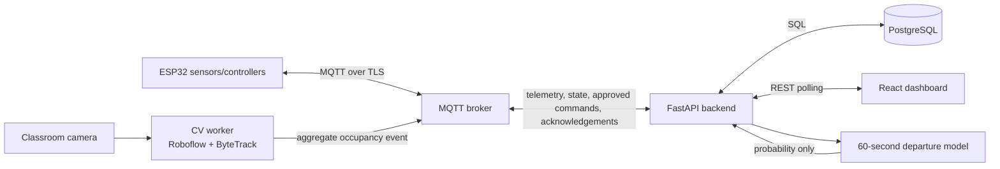
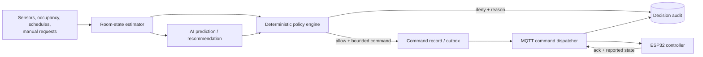

# Complete Software Architecture

## 1. Architectural style

The first production shape is a **modular monolith plus two isolated compute
workers**:

- The FastAPI backend is the system of record and orchestration boundary.
- The computer-vision worker owns frame capture, Roboflow inference and
  ByteTrack state.
- The prediction worker may initially run inside the backend process, then move
  to its own worker without changing its input/output contracts.
- ESP32 nodes communicate only through the MQTT broker.
- React communicates with FastAPI over REST. The dashboard polls for updates;
  WebSocket delivery is deferred.

This is simpler to operate than premature microservices while preserving clear
module boundaries. Scale-out points are MQTT ingestion, CV inference and
prediction inference.

## 2. System context



## 3. Safety-critical command path



The following invariant must hold in code, broker ACLs and tests:

> No AI or CV identity may publish to a device command topic. A device command
> must reference an allowed `control_decision`, and only the command dispatcher
> has MQTT publish permission for command topics.

## 4. Backend modules

| Module | Responsibility | Must not do |
|---|---|---|
| API | Authentication, validation and REST transport | Publish MQTT commands directly |
| Telemetry ingestion | Validate MQTT envelopes, deduplicate, persist readings | Infer actuator intent |
| Room-state estimator | Produce a freshness-aware current snapshot | Control appliances |
| Prediction | Return probability of departure within 60 seconds | Return a device command |
| Recommendation | Convert predictions/state into advisory actions | Bypass policy checks |
| Control policy | Apply deterministic rules and produce allow/deny decision | Call an AI model |
| Command service | Persist approved commands and manage lifecycle | Create an unapproved command |
| MQTT dispatcher | Publish persisted commands and consume acknowledgements | Change policy decisions |
| Scheduler | Emit control requests at due times | Publish directly to MQTT |
| Energy analytics | Aggregate readings and compare with versioned baselines | Claim causal savings without a baseline |

Recommended FastAPI dependency direction:

```text
api/workers -> services -> domain
api/workers -> repositories/integrations
repositories/integrations -> domain interfaces
domain -> no FastAPI, SQLAlchemy, MQTT or model SDK imports
```

## 5. State and data flow

1. ESP32 devices publish environment, power, availability and reported-state
   messages. The CV worker publishes aggregate occupancy observations.
2. The MQTT ingestion worker authenticates the broker identity, validates the
   Pydantic payload, checks timestamp bounds and deduplicates `message_id`.
3. Valid events are stored as append-only observations; current-state tables are
   updated transactionally.
4. The room-state estimator marks each input `fresh`, `stale` or `unknown`. Stale
   occupancy must never be interpreted as confirmed vacancy.
5. The prediction service consumes a fixed, versioned feature vector and stores
   a prediction with model version, probability and expiry time.
6. Recommendations are advisory records. The policy service independently loads
   authoritative state and checks hard constraints.
7. An allowed decision and its command are written atomically. A dispatcher
   publishes the command with an idempotency key and waits for acknowledgement.
8. Device acknowledgements and state reconciliation update command status and
   persisted state. The dashboard sees updates on its next REST poll.

## 6. Deterministic control precedence

Highest precedence wins:

1. Emergency stop / device safety interlock.
2. Device capability and electrical limits.
3. Data freshness, communications health and command cooldown.
4. Active manual override.
5. Authorized one-time manual command.
6. Active schedule.
7. Occupancy and vacancy automation.
8. Comfort and lighting optimization.
9. AI recommendation.

Manual override means that automatic rules are suspended for the scoped device;
it does not bypass hard electrical, capability or authorization limits.

## 7. Occupancy and privacy

- Roboflow produces person bounding boxes; ByteTrack associates anonymous,
  process-local track IDs across frames.
- The CV worker publishes count, confidence, entry/exit deltas and observation
  timestamp. Track IDs, frames and crops are not persisted by default.
- No face detection, recognition or biometric templates are permitted.
- Camera frames stay on the CV host unless an explicit, documented diagnostic
  mode is enabled. Diagnostic retention must have a short TTL and access audit.
- If the CV feed is stale, occupancy becomes `unknown`, not `vacant`.
- Vacancy-triggered shutoff requires continuous, fresh zero-count observations
  for the configured grace period.

## 8. Prediction boundary

The model predicts `P(all occupants leave within 60 seconds)`. Its result
contains model version, feature-set version, creation time and expiry time.
Prediction features can include recent count trend, tracked exit direction,
time-of-day, scheduled end time, door activity and recent environmental state.

The model output may recommend staging a device change, delaying a new cooling
cycle or preparing a vacancy timer. It cannot prove vacancy and cannot suppress
comfort or safety rules. Expired predictions are ignored.

## 9. Reliability model

- MQTT commands use QoS 1 and an idempotency key. ESP32 firmware must treat a
  repeated command ID as the same command.
- The backend uses a transactional command outbox represented by persisted
  `device_commands` rows in `queued` state.
- Desired state and reported state are distinct. A command is not `applied`
  until the device acknowledges it or reports the matching state.
- Timeouts retry with bounded exponential backoff, then raise an alert.
- Retained MQTT state is acceptable for availability and reported state, never
  for commands or acknowledgements.
- All timestamps are UTC ISO 8601 on the wire and `timestamptz` in PostgreSQL.
- API, MQTT and WS payloads carry a schema version.

## 10. Security model

- TLS for browser/API and MQTT connections; per-device broker credentials.
- Broker ACLs restrict each device to its classroom and hardware identity.
- JWT/OIDC API authentication with `viewer`, `operator` and `admin` roles.
- Operators may request commands and overrides; only admins manage policy and
  device configuration.
- Secrets are provided through environment/secret storage, never committed.
- Every manual request, override, decision, command and acknowledgement is
  attributable and timestamped.
- Raw MQTT payloads that fail validation are quarantined with bounded retention
  and must not update current state.

## 11. Deployment topology

For development, run PostgreSQL, an MQTT broker, FastAPI, a CV worker and React
on one secured network. In deployment, put the CV worker near the classroom
camera, keep controllers on an isolated IoT VLAN, and expose only the API reverse
proxy to browser clients. PostgreSQL and MQTT administration ports remain
private.

## 12. Observability

Use structured logs with `trace_id`, `classroom_id`, `device_id`, `decision_id`
and `command_id`. Track telemetry age, dropped/invalid MQTT messages, prediction
latency, policy denials by reason, command acknowledgement latency, device
offline duration, WS clients and estimated-versus-actual energy. Never log API
keys, tokens, raw frames or unrestricted MQTT credentials.

## 13. Testing strategy

- Unit tests: domain policy truth tables, prediction feature creation, energy
  formulas and schema validation.
- Contract tests: Pydantic examples, TypeScript fixtures and MQTT topic/payload
  compatibility.
- Integration tests: PostgreSQL transactions, MQTT QoS/idempotency and command
  acknowledgement reconciliation.
- Simulation tests: scripted occupancy/sensor/device sequences including stale
  data, oscillating counts, offline devices and duplicate messages.
- Hardware-in-the-loop: relays disconnected from mains first, then supervised
  low-risk loads before high-power appliance integration.
