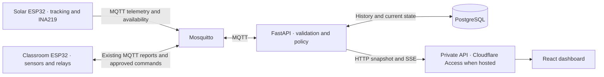

# Solar tracker dashboard

Open **Solar tracker** in the dashboard navigation. The tab shows target and actual azimuth and zenith, commanded motor outputs, solar voltage, current, power, accumulated energy, and recent plots. It also shows GPS status when GPS tracking is enabled. The connection overview shows both ESP32 boards and the backend’s connection to Mosquitto. The existing **Devices** and **Appliances tracking** tabs still show the classroom controller’s relay controls and recorded runtime.

## Data flow



Mosquitto is already part of this project. The solar board publishes through a dedicated account that has write access to just its own telemetry and status topics. The backend subscriber uses its separate read account. The existing relay command, acknowledgment, and runtime paths stay on their existing topics. Browser requests use the existing FastAPI access controls and private Worker proxy when hosted.

## 1. Prepare the existing services

From the repository root, confirm `infra/mosquitto/password_file` exists. Follow the [classroom controller setup](../firmware/esp32/README.md#local-setup) for an initial broker installation. For an existing broker, add a distinct password for the solar board. The command omits `-c` so existing broker accounts are retained.

```powershell
$mqttConfig = (Resolve-Path .\infra\mosquitto).Path
docker run --rm -it --mount "type=bind,source=$mqttConfig,target=/mosquitto/config" eclipse-mosquitto:2 sh -c 'mosquitto_passwd /mosquitto/config/password_file aceo-esp32-solar-tracker && chown mosquitto:mosquitto /mosquitto/config/password_file && chmod 600 /mosquitto/config/password_file'
docker compose up -d --wait postgres mqtt
docker compose restart mqtt
```

The restart loads the updated ACL and password file. Connected clients reconnect after the restart. For an existing PostgreSQL volume, apply migration 005. A new volume initializes from the current schema.

```powershell
Get-Content .\database\migrations\005_solar_monitor.sql |
  docker compose exec -T postgres psql -v ON_ERROR_STOP=1 -U aceo -d aceo
```

Use the broker computer’s LAN address on the ESP32 and `localhost` for a backend on the same host. TCP `1883` is the existing authenticated development listener. Keep it on the private network. For TLS, provision a PEM server certificate chain and matching private key in `infra/mosquitto/tls/` as `server-chain.pem` and `server-key.pem`. The Mosquitto process in the container needs read access. The certificate must cover the hostname entered on the board. Start the same broker with its optional TLS listener on TCP `8883`.

```powershell
docker compose -f compose.yaml -f compose.mqtt-tls.yaml up -d --wait postgres mqtt
```

Use the TLS port and CA certificate in the solar board settings. The ESP32 needs a valid system clock for certificate verification. The relay controller can continue using the private LAN listener with its existing firmware. The browser connects over HTTP locally or HTTPS through Cloudflare Access when hosted. See the [Mosquitto listener reference](https://mosquitto.org/man/mosquitto-conf-5.html).

## 2. Configure and upload the solar firmware

The complete sketch is in `firmware/solar_tracker/solar_tracker_esp32_only/`. Put your local `spa.c` and `spa.h` in that folder with the `.ino`. The [lab’s SPA distribution](https://midcdmz.nlr.gov/spa/) supplies these files for local use under its terms. The firmware uses **esp32 by Espressif Systems** in Arduino IDE, the **Adafruit INA219** library (version 1.2.3 for the build), and the core’s ESP-MQTT support. Keep the board selection used for the working tracker. The generic development target is **ESP32 Dev Module** on Arduino-ESP32 3.3.12.

Copy `solar_mqtt_secrets.example.h` to `solar_mqtt_secrets.h` in the same folder. Set `kEnabled` to `true`, fill in the 2.4 GHz Wi-Fi credentials, and set the broker hostname, `aceo-esp32-solar-tracker` username, and its password. For the local development listener, set `kBrokerPort` to `1883` and `kUseTls` to `false`. For TLS, set the port to `8883`, set `kUseTls` to `true`, and supply the broker’s trusted CA in `kBrokerCaPem`. Keep the site, classroom, and producer IDs aligned with the broker ACL and backend settings. The default `kTelemetryIntervalMs` is 1,000. `SOLAR_STALE_AFTER_SECONDS` defaults to 5 on the backend. Increase the freshness window if you intentionally increase the firmware interval. All credentials and local SPA files are ignored by Git.

1. Open `solar_tracker_esp32_only.ino` in Arduino IDE, select the tracker’s board and COM port, then click **Verify**.
2. Confirm the COM port belongs to the solar tracker and upload the verified sketch. Open Serial Monitor at **115200 baud** and check for Wi-Fi and MQTT connection messages.
3. Keep motor power disconnected for the first boot check. The firmware starts in fixed-tilt mode with the motors disarmed. GPS is disabled in the default build. Check `LATITUDE`, `LONGITUDE`, and `TZ_OFFSET_HOURS` for the installation site.

### Fixed-tilt automatic tracking

Set Serial Monitor to **115200 baud** with a newline ending. Enter `tYYYYMMDDhhmmss` with the current Malaysia date and time. Point the base true south, hold it still, and send `h`. The gyro calibrates for about three seconds. If the tracker reports **ready: send a**, send `a` to arm automatic yaw. Send `s` or `STOP` to disarm. To use another measured bearing, replace `h` with a command such as `b90` for true east. The reference expires after 10 minutes, and a new clock setting clears it.

Fixed mode keeps the tilt motor off. Both current and target bearing must be within 55°–305°, and the target must be above the horizon. The controller disarms when a gate fails. Wrong direction and stalled motion require correcting the fault and rebooting. The dashboard shows calculated solar zenith, calibration, reachability, arming, and any available angle and electrical readings. The optional `x1`–`x600` commands change the solar clock speed for a demo and disarm the tracker. Use `x1` for real-time tracking. An accelerated solar clock does not change MQTT sample times or energy integration.

### Dual-axis tracking

Send `AUTO` to select dual-axis solar tracking. With GPS disabled, this mode uses the configured site coordinates and the ESP32’s network clock. A valid local time entered with `T YYYY MM DD HH MM SS` while in dual-axis mode overrides network time for tracking until reboot. AUTO holds the motors stopped until a valid clock is available. `MANUAL <azimuth> <zenith>` uses the supplied targets without a clock. Both axes require valid feedback, and a zenith target of 90° or more stops both motors. Set `USE_GPS_FOR_TRACKING` to `true` in the sketch to restore the GPS position and time requirement for dual-axis AUTO.

### Base rotation test

Open Serial Monitor at 115200 baud with a newline line ending. Use `TEST` first to check the base direction and travel. The commands work independently of GPS, network time, and the tilt sensor:

| Command | Result |
| --- | --- |
| `TEST` | Estimate 10° of clockwise base rotation, pause for 500 ms, then estimate 10° anticlockwise. |
| `RUN` | Estimate 360° clockwise, pause for 500 ms, then estimate 300° anticlockwise. Check full travel and cable clearance before using it. |
| `STOP` | Cancel a sequence and hold both motors stopped. |
| `AUTO` or `MANUAL <azimuth> <zenith>` | Leave the hold and return to the selected tracking mode. Send `STOP` first if a sequence is active. |

The sequence keeps the tilt motor off and holds both motors stopped on completion or fault. It checks for a gyro read failure, missed samples, wrong direction, stalled travel, or a timed-out leg. Actual travel is estimated from the gyro and shown on the Solar tracker tab alongside duty and electrical readings.

The sketch hands a snapshot to the network task with a bounded, overwrite-latest queue. Actual angles from valid feedback and valid INA219 readings remain available with motors stopped, including while AUTO waits for time. Target angles are available once AUTO has time or after a manual target is set. The Wh accumulator restarts at boot and can reset through `RESET_WH`.

The solar freshness timeout applies to the backend receipt time. The additional 30-second allowance on the tracker’s reported sample timestamp accounts for clock differences between the ESP32 and the backend.

## 3. Start and verify the dashboard

From `backend/`, start FastAPI with `uv run python -m uvicorn app.main:app --reload --port 8000`. From `frontend/`, start the dashboard with `pnpm dev`. Local frontend settings should point `NEXT_PUBLIC_API_BASE_URL` to `http://localhost:8000` and use the same `NEXT_PUBLIC_CLASSROOM_ID` as the tracker. The solar panel uses its own live API while the existing aggregate dashboard can keep demo mode enabled.

1. Check `http://localhost:8000/health/ready` and open **Solar tracker** from `http://localhost:3000`. Broker status represents FastAPI’s MQTT session. The board rows separately report availability and when data last arrived.
2. With both boards on Wi-Fi and configured for the same broker, check that solar values appear under **Solar tracker** and the classroom controller keeps updating **Devices** and **Appliances tracking**. Compare azimuth, zenith, volts, amps and watts with Serial at the same time. Compare commanded motor duty with the controller’s output. Duty is not movement feedback.
3. Disconnect the tracker from Wi-Fi while monitoring its Serial output. After clock synchronization, the ESP32 keeps time during the outage. The dashboard should flag stale data before the broker detects the lost connection through the Last Will. Reconnect Wi-Fi and check that fresh samples resume. Repeat for the classroom ESP32 and verify local sampling and the held relay state. Request a new classroom control command after reconnection and check for the existing acknowledgement.
4. Keep motor power disconnected for the first boot check. Confirm fixed tilt is disarmed, the GPS card is hidden, and available electrical readings appear. Enter the local clock, calibrate at a known bearing, and check that `a` is accepted only when ready. Verify tilt PWM stays zero, then send `s` and confirm yaw PWM returns to zero. With the unit powered down, disconnect an optional INA219 for a controlled verification. After power-up confirm electrical readings are unavailable. An absent zenith MPU prevents dual-axis motion.
5. Reload the page and verify that recent history returns without filling gaps with zeros. For the seeded classroom, use these endpoints to check the server snapshot and stream directly.

```powershell
$monitor = 'http://localhost:8000/api/v1/classrooms/26e97d46-7a34-4439-922a-83684bda557d/prototype-monitor'
Invoke-RestMethod $monitor
curl.exe -N "$monitor/stream"
```

For the hosted website, use the existing [Cloudflare Access and private FastAPI bridge](cloudflare-live.md). Apply the database migration and update FastAPI before deploying the Worker and frontend with the existing `pnpm run deploy` workflow. Keep `NEXT_PUBLIC_API_BASE_URL` empty for same-origin API access. The Worker allowlists both solar read routes. Each SSE connection has a bounded lifetime and reconnects through the authenticated edge.

## Troubleshooting

| Symptom | Check |
| --- | --- |
| Solar tab is missing | Restart the frontend from the updated checkout and reload the browser. |
| Waiting for tracker data | Check the board is running the MQTT-enabled sketch. Verify its Wi-Fi, broker host and port, password, matching site/classroom/producer IDs, and Mosquitto ACL. |
| TLS handshake fails | Verify the board has time from its configured NTP source, the certificate matches the broker hostname, and the CA is correct. |
| Board status is online and telemetry is stale | Check the board’s serial output and the backend for rejected JSON or identity mismatches. The retained status and valid sample age are tracked independently. |
| API reports a database error | For an existing volume, apply migration 005 and restart FastAPI. Keep PostgreSQL running when checking history. |
| Targets unavailable with a connected broker | Check the stop reason. In fixed-tilt mode, set the Malaysia clock with `tYYYYMMDDhhmmss`. Dual-axis AUTO uses network time or a local time entered with `T`. The electrical readings and actual angles depend on valid samples from the respective sensors. |
| `feedback_unavailable` and `INA219 power unavailable` | Check sensor power and common ground while keeping motor power off. Both sensors share SDA (GPIO21) and SCL (GPIO22). The base MPU should respond at `0x68` and INA219 at `0x40`. After restoring the sensor connections, `h` retries unavailable sensors before calibrating. |
| Hosted dashboard cannot connect to the stream | Verify the Worker and FastAPI are both updated, the tunnel and private bridge are healthy, and the user is signed in through Cloudflare Access. |
